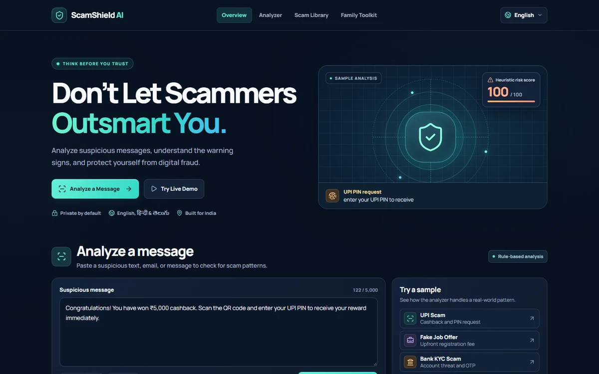

# ScamShield AI and ScamShield AI Pro

**Think Before You Trust.**

Your Intelligent Defense Against Digital Scams.

ScamShield AI helps people in India inspect suspicious messages from WhatsApp, SMS, email, Telegram, social media and job ads. It shows which phrases triggered warnings, explains why they matter and points people to safer next steps. Built for the GeeksforGeeks × OpenAI Build with Codex competition.

## The problem

Fraudulent messages use familiar brands, high-pressure deadlines and requests for payments or credentials to make a decision feel urgent. ScamShield gives people a way to pause, inspect those signals and explain them to someone else before taking action.

The competition description, spoken script and four reproducible demo scores are in the [presenter guide](COMPETITION.md).

## Implemented features

- Browser-based analysis of ten India-relevant scam patterns, including UPI, job fees, KYC, credentials, delivery and impostor messages.
- Exact evidence highlights, per-finding point contributions, an interactive safety checklist and a copyable response. Each distinct rule contributes once. The score is capped at 100.
- Four demos that use the same analysis engine as pasted messages.
- English, Hindi and Telugu navigation, explanations, guides and shareable family warnings. Quotes stay in the original language.
- Searchable awareness library and family warnings generated from translated safety templates.
- Official links to the [National Cyber Crime Reporting Portal](https://cybercrime.gov.in/) and [NPCI Fraud Awareness](https://www.npci.org.in/fraud-awareness), plus India’s [1930 financial cyber fraud helpline](https://mrm-ncrp.mha.gov.in/restoration/).
- Pro analysis with Google Gemini, Groq, OpenAI, and same-computer Ollama. Pro adds red-flag explanations and verification steps, manipulation tactics, financial and link warnings, possible consequences, prioritized actions, and follow-up chat.
- Session-only API keys, provider model discovery, an editable model ID, a real connection test, and provider-reported token usage where available.
- A Basic/Pro comparison for the same message, independent analysis and chat languages, and a review of the text before cloud submission.
- Keyboard-operable guides and findings, visible focus indicators, reduced-motion support, mobile layouts and localized input validation.

## Run locally

Install Node.js 22 or later and open a terminal in this directory.

~~~sh
npm ci
npm run dev
~~~

Open [localhost:3000](http://localhost:3000). The default engine needs no account, API key or database.

For a presentation, run a production build from the same directory.

~~~sh
npm run build
npm start
~~~

## Connect a cloud provider

Choose **Pro AI Analysis → AI Settings**, select a provider, and enter that provider’s API key. Acknowledge the cloud disclosure and select **Load models**. Choose a model or enter its ID. Select **Test Connection**, then **Save for Current Session**. The test makes a small generation request with no message attached, so it can use provider quota. Save keeps the configuration in memory and sends nothing.

| Provider | API key and model compatibility | Pricing |
| --- | --- | --- |
| Google Gemini | Create a Developer API key, then choose a Gemini text model that supports structured output. [Google AI Studio keys](https://aistudio.google.com/apikey) · [Structured output](https://ai.google.dev/gemini-api/docs/structured-output) | [Gemini pricing](https://ai.google.dev/gemini-api/docs/pricing) |
| Groq | Create a GroqCloud key, then choose a chat model that supports JSON mode. [GroqCloud keys](https://console.groq.com/keys) · [Model catalog](https://console.groq.com/docs/models) | [Groq pricing](https://groq.com/pricing/) |
| OpenAI | Create an API project key, then choose a Responses API model with Structured Outputs. API billing is separate from ChatGPT subscriptions. [OpenAI project keys](https://platform.openai.com/api-keys) · [Structured Outputs](https://developers.openai.com/api/docs/guides/structured-outputs) | [OpenAI API pricing](https://openai.com/api/pricing/) |

ScamShield has no subscription or account requirement. Cloud free-tier eligibility, quotas, and charges depend on the selected model and provider account. The saved key clears on refresh, provider change, or **Clear API Key / Disconnect**.

## Use Ollama on the same computer

1. Install Ollama, disable cloud features, and restart Ollama. Set OLLAMA_NO_CLOUD=1 in the Ollama process or use its documented local-only configuration. Keep the listener on 127.0.0.1:11434. [Ollama downloads](https://ollama.com/download) · [Ollama local configuration](https://docs.ollama.com/faq#how-do-i-disable-ollamas-cloud-features)
2. Run ollama pull with the name of a locally runnable text model and use ollama list to confirm the exact installed tag. Choose a model that fits your RAM or VRAM and handles JSON structured output. [Ollama model library](https://ollama.com/library) · [Structured outputs](https://docs.ollama.com/capabilities/structured-outputs)
3. Add SCAMSHIELD_ENABLE_OLLAMA=true to .env.local in the ScamShield project and run npm run dev -- --hostname 127.0.0.1. Open [the loopback development URL](http://127.0.0.1:3000).
4. Open **Pro AI Analysis → AI Settings → Local Ollama**. Select **Load models**, choose an installed tag, test, and save. The API key field is hidden for Ollama.

The browser calls the same-origin Next.js route. The local development instance calls Ollama over loopback, so this flow needs no browser CORS changes or exposed port. Production builds disable the Ollama route even if the flag is set.

## Try a Pro analysis

1. Paste a synthetic message, such as “Your account will be blocked today. Share your OTP using this link.” Review the outbound text for cloud mode.
2. Submit **Pro AI Analysis**. The dashboard displays the provider, model, completion status, and available token counts. Expand **Original message** to see the exact quoted phrases highlighted.
3. Compare **Basic Analysis** and **Pro AI Analysis** for the same text. A provider failure shows the error and keeps the input available for Basic.
4. Use the analysis language selector to explicitly re-run in English, Hindi, or Telugu. Ask a follow-up in the chat language of your choice. Follow-ups use the provider and model on the current Pro result. After switching providers, re-run the analysis before continuing. Clearing chat removes that session’s chat history.

The four built-in demos still use the deterministic Basic engine. The legacy optional managed OpenAI context is also available separately when the operator configures OPENAI_API_KEY and optionally OPENAI_MODEL. BYOK does not require those environment variables.

## Stack and structure

Next.js App Router, React, TypeScript, Tailwind CSS, Lucide, Google GenAI SDK, OpenAI SDK, Zod, Node’s test runner, and Playwright.

| Path | Responsibility |
| --- | --- |
| src/app | Page, theme, metadata and optional analysis endpoint |
| src/components | Analyzer, results, library, family toolkit and shared controls |
| src/lib/analysis.ts, src/lib/rules.ts, src/lib/links.ts | Weighted rule engine, localized signal definitions and offline URL inspection |
| src/lib/copy.ts, src/lib/library.ts, src/lib/samples.ts | Interface translations, safety guides and demo inputs |
| src/lib/server | Provider adapters, prompt construction, and structured response validation |
| src/lib/pro.ts | Shared request and analysis contracts |
| tests | Engine, output validation, privacy and browser flows |

## Run the checks

~~~sh
npm run typecheck
npm run lint
npm test
npm run build
npx playwright install chromium
npm run test:e2e
~~~

To use an existing Chrome install, set PLAYWRIGHT_CHANNEL=chrome before running the browser suite. Playwright starts the production build on port 3179 and checks both desktop and mobile viewports. Test fixtures intercept provider requests. The suite spends no provider quota. For manual testing, enter a valid test key through AI Settings on localhost or over HTTPS.

## Deploy to Vercel

1. Push this directory to a GitHub repository.
2. Import it in Vercel using the Next.js preset and Node.js 22.x or later. If it sits inside another repository, select this directory as the Root Directory.
3. Deploy with the standard Next.js build settings and use the deployment’s HTTPS URL. Cloud BYOK works without deployment API keys. Add OPENAI_API_KEY only if you intend to offer the optional legacy operator-funded context.

Use an edge or shared rate limiter before exposing the AI endpoint to significant public traffic. Its basic quotas are per server instance and reset when the instance restarts.

## Privacy

The default engine keeps message content in page memory. Only the interface language preference is stored in local storage. Family warnings draw from templates and category IDs, so they contain no message excerpts, names, phone numbers or codes. Submitted links are parsed as strings and never opened. Pasted markup is displayed as plain text.

With explicit opt-in, the browser masks common phone and account numbers, email and UPI-style addresses, labeled codes, and recognized password assignments. The server repeats masking before sending the text, selected language, and relevant context to the fixed provider endpoint. The key travels in a POST body and is available to the server during that request. The app keeps keys in browser memory, never logs them, and does not use cookies, local storage, analytics, or a database for credentials. Avoid collecting request payloads in deployment logging or monitoring.

Cloud follow-ups send the masked message, current question, and up to two recent exchanges. Quotes in the analysis must match visible portions of the submitted text. Provider data-use and billing terms apply. OpenAI requests set store to false. The route limits requests by origin, size, time, and rate, and uses a fixed destination. Production disallows Ollama. [OpenAI API data controls](https://developers.openai.com/api/docs/guides/your-data)

## Known limitations

- **Scoring** measures the weight of matching text patterns. Sender identity, account ownership and the probability of fraud require other evidence.
- **Language coverage** is strongest for common English, Hindi and Telugu wording. Paraphrases, transliteration, mixed scripts and discussions about scams can produce missed signals or false alarms. For an unrecognized script with no matching evidence, the UI displays a coverage limitation.
- **Link analysis** checks the written URL. Destination content and reputation are outside its scope. Official channels handle complaints.
- **Masking** recognizes common formats. Free-form personal details and unfamiliar credential formats may still reach the provider when AI is enabled.
- **Model catalogs** reflect API availability. A listed model may still lack permission, quota, or support for the requested JSON mode. Use the connection test and expect stricter validation for the full report.
- **Live providers** require valid user credentials or an installed Ollama engine and model. Automated validation covers the four provider request contracts with fixtures. This release did not verify external accounts or physical Ollama hardware.
- **Browser coverage** includes desktop Chrome and mobile Chromium emulation. Physical-device, Safari and assistive-technology user testing remain open. Clipboard access depends on browser permissions and a secure context such as HTTPS or localhost.

## Release verification

The Pro release passed 27 engine, privacy, SDK, and route tests, 26 desktop/mobile browser tests, TypeScript, ESLint, and the Next.js production build. Responsive tests checked Pro results from 320 to 1440 CSS pixels.

The automated suite covers provider switching, connection errors, exact-quote rejection, masking and storage boundaries, analysis and follow-up languages, Basic comparison, and the four original demos. The local production build can run Basic and cloud BYOK without server credentials.

The browser suite clicks each sample, manually submits the same text and compares the displayed scores and quotes with the actual engine. It also exercises validation, clipboard actions, translated guidance, the family toolkit, the checklist, privacy and API fallbacks.

The release review inspected all ten library entries, all 33 family-warning topic/language combinations and eight widths from 320 to 1440 CSS pixels in each interface language. It checked client assets for a synthetic server-secret marker, inspected outgoing requests, and ran automated accessibility checks on desktop and narrow layouts with results expanded.

The tested layouts had no horizontal overflow. The two English expanded-results accessibility scans reported zero violations. The optional AI interface was also exercised with isolated test responses for loading, contextual results and invalid quotes, and with an unavailable service to verify local fallback. The four presentation demos use the local engine.

## Competition roadmap

1. **Week 1** — Evaluate the engine on consented or synthetic, de-identified examples in English, Hindi, Telugu and mixed scripts. Track missed signals and false alarms by category.
2. **Week 2** — Improve common transliterations and test the explanations with native speakers and people who need plain-language guidance.
3. **Week 3** — Prototype on-device screenshot OCR with editable extraction, then test on low-end Android devices and slower connections.
4. **Week 4** — Test live AI against a curated evaluation set, add shared rate limits if AI is enabled publicly and rehearse the presentation on a deployed preview.
